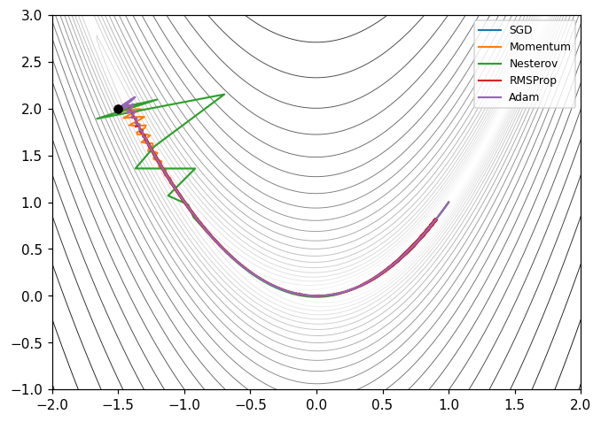
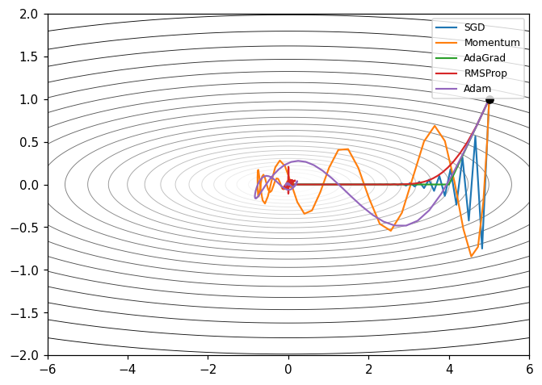
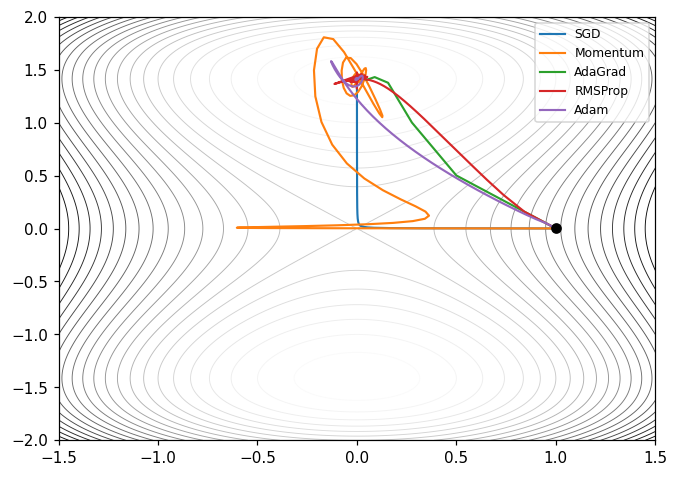

# Optimizer: Cara Model Benar-Benar Belajar

**🇬🇧 [English](README.md) | 🇮🇩 Bahasa Indonesia**

🏠 Kembali ke Topik Lanjutan: `../README.md`

Setiap model di repositori ini yang dilatih dengan gradien (regresi logistik,
jaringan saraf, CNN, dan detektor mini YOLO) bergantung pada satu potongan kode
kecil: **optimizer**, yaitu aturan yang mengubah gradien menjadi pembaruan
parameter. Modul ini mengimplementasikan optimizer terpenting dari nol dengan
**NumPy saja**, membandingkannya pada fungsi uji klasik dan model kecil, serta
menjelaskan kapan masing-masing cocok dipakai.

Yang akan kamu bangun:

- SGD, SGD mini-batch, Momentum (heavy ball), momentum Nesterov,
- AdaGrad, RMSProp, Adam (dengan koreksi bias) dan AdamW,
- jadwal laju belajar: penurunan bertahap, kosinus, dan pemanasan linear,
- tiga soal uji 2-D: Rosenbrock, kuadratik berkondisi buruk, dan titik pelana,
- loop pelatihan mini-batch untuk regresi logistik dan MLP kecil,
- pemeriksa gradien numerik dan plot lintasan.

Semua data sintetis, semuanya berjalan di CPU dalam hitungan detik.

## 📚 Daftar Isi

- [Ide Dasar](#-ide-dasar)
- [Batch Penuh, Mini-Batch, dan Stokastik](#-batch-penuh-mini-batch-dan-stokastik)
- [Momentum dan Nesterov](#-momentum-dan-nesterov)
- [Metode Adaptif: AdaGrad dan RMSProp](#-metode-adaptif-adagrad-dan-rmsprop)
- [Adam dan Koreksi Bias](#-adam-dan-koreksi-bias)
- [AdamW: Peluruhan Bobot Terpisah](#-adamw-peluruhan-bobot-terpisah)
- [Jadwal Laju Belajar](#-jadwal-laju-belajar)
- [Fungsi Uji](#-fungsi-uji)
- [Mulai Cepat](#-mulai-cepat)
- [Hasil](#-hasil)
- [Memilih Optimizer](#-memilih-optimizer)
- [Latihan Notebook](#-latihan-notebook)
- [Pengujian](#-pengujian)
- [Berkas di Direktori Ini](#-berkas-di-direktori-ini)
- [Referensi](#-referensi)

## 🧠 Ide Dasar

Melatih model berarti meminimalkan fungsi kerugian $L(\theta)$ terhadap
parameter $\theta$. Gradien $g_t = \nabla L(\theta_t)$ menunjuk ke arah naik,
jadi penurunan gradien melangkah ke arah turun:

$$
\theta_{t+1} = \theta_t - \eta \, g_t
$$

Laju belajar $\eta$ adalah hiperparameter paling penting. Terlalu kecil,
pelatihan merayap; terlalu besar, iterasinya berosilasi atau meledak. Untuk
fungsi kuadratik dengan kelengkungan $\lambda_{\min} \le \dots \le \lambda_{\max}$,
penurunan gradien biasa hanya stabil bila $\eta < 2/\lambda_{\max}$, dan arah
yang lambat lalu menyusut kira-kira dengan faktor $1 - \lambda_{\min}/\lambda_{\max}$
per langkah. Rasio $\kappa = \lambda_{\max}/\lambda_{\min}$ disebut
**bilangan kondisi**; $\kappa$ besar berarti lembah yang panjang dan sempit,
dan itulah masalah yang coba diatasi oleh sebagian besar optimizer di bawah.

## 🎲 Batch Penuh, Mini-Batch, dan Stokastik

Gradien penuh adalah rata-rata dari seluruh $n$ contoh latih. Menghitungnya di
setiap langkah itu mahal, jadi dalam praktik kita menaksirnya pada
**mini-batch** acak $B$:

$$
g_t \approx \frac{1}{|B|} \sum_{i \in B} \nabla \ell_i(\theta_t)
$$

- `batch_size=None`: penurunan gradien batch penuh (mulus tetapi lambat per pembaruan),
- `batch_size=1`: penurunan gradien stokastik murni (sangat berisik),
- `batch_size=32` sampai `256`: kompromi yang umum, dan disukai GPU.

Derau ini bukan hanya kerugian: ia membantu lolos dari titik pelana dan daerah
datar. Di `implementation.py`, ukuran batch adalah argumen `train(...)`, jadi
setiap optimizer bisa dipakai dalam ketiga mode tersebut.

## 🏃 Momentum dan Nesterov

**Momentum** (bola berat Polyak, 1964) menyimpan kecepatan berjalan sehingga
arah gradien yang konsisten terakumulasi dan arah yang bolak-balik saling
meniadakan:

$$
v_{t+1} = \beta v_t + g_t, \qquad \theta_{t+1} = \theta_t - \eta \, v_{t+1}
$$

Dengan $\beta = 0{,}9$, langkah efektif ke arah yang konsisten kira-kira sepuluh
kali lebih besar, sementara zig-zag melintasi lembah sempit diredam.

**Gradien dipercepat Nesterov** (1983) menghitung gradien di titik tujuan
momentum, sehingga lonjakan berlebih dikoreksi lebih awal. Bentuk yang dipakai
sebagian besar pustaka (dan di sini) adalah

$$
v_{t+1} = \beta v_t + g_t, \qquad \theta_{t+1} = \theta_t - \eta \,(g_t + \beta v_{t+1})
$$

Untuk soal konveks yang mulus, metode Nesterov mencapai laju optimal
$O(1/t^2)$ di antara metode orde pertama, dibandingkan $O(1/t)$ untuk
penurunan gradien biasa.

## 📐 Metode Adaptif: AdaGrad dan RMSProp

Alih-alih satu laju belajar global, metode adaptif memberi setiap parameter
ukuran langkahnya sendiri berdasarkan riwayat gradiennya.

**AdaGrad** (Duchi, Hazan & Singer, 2011) membagi dengan akar dari jumlah
kuadrat gradien yang terakumulasi:

$$
G_t = G_{t-1} + g_t^2, \qquad \theta_{t+1} = \theta_t - \frac{\eta}{\sqrt{G_t} + \epsilon} \, g_t
$$

(semua operasi per elemen). Fitur yang jarang muncul mendapat langkah besar,
fitur yang sering muncul mendapat langkah kecil, sehingga cocok untuk data
renggang. Karena $G_t$ terus bertambah, laju belajar efektifnya terus mengecil
dan pelatihan bisa macet.

**RMSProp** (Tieleman & Hinton, 2012, kuliah Coursera 6.5) mengganti jumlah
tersebut dengan rata-rata bergerak eksponensial sehingga gradien lama
dilupakan:

$$
s_t = \rho \, s_{t-1} + (1 - \rho) \, g_t^2, \qquad
\theta_{t+1} = \theta_t - \frac{\eta}{\sqrt{s_t} + \epsilon} \, g_t
$$

## ⚙️ Adam dan Koreksi Bias

**Adam** (Kingma & Ba, 2014) menggabungkan momentum (momen pertama) dengan
penskalaan RMSProp (momen kedua):

$$
m_t = \beta_1 m_{t-1} + (1 - \beta_1) g_t, \qquad
v_t = \beta_2 v_{t-1} + (1 - \beta_2) g_t^2
$$

Kedua momen dimulai dari nol, jadi pada awalnya keduanya condong ke nol. Bila
rekursinya dijabarkan, diperoleh $\mathbb{E}[m_t] \approx (1 - \beta_1^t)\,\mathbb{E}[g]$,
yang menjadi dasar **koreksi bias**

$$
\hat m_t = \frac{m_t}{1 - \beta_1^t}, \qquad \hat v_t = \frac{v_t}{1 - \beta_2^t}, \qquad
\theta_{t+1} = \theta_t - \eta \, \frac{\hat m_t}{\sqrt{\hat v_t} + \epsilon}
$$

Akibat yang berguna: pada langkah pertama $\hat m_1 = g_1$ dan
$\hat v_1 = g_1^2$, sehingga setiap parameter bergerak hampir tepat sebesar
$\eta$, berapa pun skala gradiennya. Pengujian memeriksa sifat ini. Tanpa
koreksi ($\beta_2 = 0{,}999$), langkah pertama akan kira-kira
$0{,}1/\sqrt{0{,}001} \approx 3{,}16$ kali lebih besar dari yang diinginkan.
Nilai bawaan: $\beta_1 = 0{,}9$, $\beta_2 = 0{,}999$, $\epsilon = 10^{-8}$.

## 🪶 AdamW: Peluruhan Bobot Terpisah

Pada SGD biasa, menambahkan penalti L2 $\tfrac{\lambda}{2}\lVert\theta\rVert^2$
ke fungsi kerugian sama dengan mengecilkan bobot di setiap langkah. Pada Adam
hal itu **tidak** berlaku: gradien penalti $\lambda\theta$ ikut dibagi
$\sqrt{\hat v_t}$, sehingga parameter dengan gradien besar nyaris tidak
teregularisasi. Loshchilov & Hutter (2019) mengusulkan agar peluruhan langsung
diterapkan pada bobot:

$$
\theta_{t+1} = \theta_t - \eta \left( \frac{\hat m_t}{\sqrt{\hat v_t} + \epsilon} + \lambda \, \theta_t \right)
$$

Di kode, `Adam(weight_decay=...)` adalah versi tergabung (L2) dan
`AdamW(weight_decay=...)` adalah versi terpisah, jadi kamu bisa
membandingkannya. Kini AdamW menjadi optimizer bawaan untuk melatih
transformer.

## 📉 Jadwal Laju Belajar

Jadwal adalah fungsi $t \mapsto \eta_t$. Setiap optimizer di
`implementation.py` menerima angka atau jadwal sebagai `lr`.

| Jadwal | Rumus | Fungsi |
|---|---|---|
| Konstan | $\eta_t = \eta_0$ | `constant_lr(lr)` |
| Penurunan bertahap | $\eta_t = \eta_0 \, \gamma^{\lfloor t / s \rfloor}$ | `step_decay(lr, step_size, gamma)` |
| Kosinus | $\eta_t = \eta_{\min} + \tfrac{1}{2}(\eta_0 - \eta_{\min})(1 + \cos(\pi t / T))$ | `cosine_decay(lr, total_steps, min_lr)` |
| Pemanasan linear | $\eta_t = \eta_0 (t+1)/W$ untuk $t < W$, lalu jadwal yang dibungkus | `warmup(schedule, warmup_steps)` |

Pemanasan paling penting untuk metode keluarga Adam pada model besar: statistik
gradien di awal masih berisik, dan beberapa ratus langkah kecil mencegah awal
yang buruk. Kosinus dengan pemanasan adalah pilihan bawaan yang umum dalam
pembelajaran mendalam modern.

```python
from implementation import Adam, cosine_decay, warmup

opt = Adam(lr=warmup(cosine_decay(1e-3, total_steps=900), warmup_steps=100))
```

## 🗺️ Fungsi Uji

| Fungsi | Rumus | Minimum | Yang diuji |
|---|---|---|---|
| Rosenbrock | $(1 - x)^2 + 100 (y - x^2)^2$ | $(1, 1)$, $f = 0$ | lembah sempit yang melengkung |
| Kuadratik berkondisi buruk | $\tfrac{1}{2}(x^2 + 50 y^2)$ | $(0, 0)$, $f = 0$ | bilangan kondisi $\kappa = 50$ |
| Pelana | $x^2 - y^2 + \tfrac{1}{4} y^4$ | $(0, \pm\sqrt 2)$, $f = -1$ | lolos dari titik pelana di titik asal |

Percobaan pelana dimulai di $(1, 10^{-3})$, hampir tepat di punggungnya, jadi
optimizer harus memperbesar komponen yang sangat kecil untuk bisa lolos.







## 🚀 Mulai Cepat

```bash
# Dari akar repositori
uv run python 04_advanced_topics/08_optimizers/implementation.py
uv run python 04_advanced_topics/08_optimizers/sklearn_example.py
uv run pytest tests/test_optimizers.py -v
```

```python
import numpy as np
from implementation import Adam, MLPModel, make_moons_np, train, accuracy

X, y = make_moons_np(400, seed=0)
model = MLPModel(n_features=2, hidden=16)
history = train(model, X, y, Adam(lr=0.01), epochs=60, batch_size=32)
print(history[-1], accuracy(model, X, y))
```

## 📊 Hasil

**Jumlah langkah hingga $f - f^\star < 10^{-6}$** (maksimum 5000 langkah).
Setiap optimizer memakai laju belajar terbaiknya dari kisi
$\{3\cdot10^{-4}, 10^{-3}, 3\cdot10^{-3}, 0{,}01, 0{,}03, 0{,}1, 0{,}3, 1\}$;
hiperparameter lain memakai nilai bawaan. AdamW dijalankan tanpa peluruhan
bobot di sini, sehingga hasilnya sama persis dengan Adam.

| Optimizer | Rosenbrock | Kuadratik ($\kappa = 50$) | Pelana |
|---|---|---|---|
| SGD | tidak tercapai ($6{,}5 \times 10^{-3}$) | 269 | 19 |
| Momentum | 1484 | 95 | 120 |
| Nesterov | 1379 | 97 | 25 |
| AdaGrad | tidak tercapai ($1{,}6 \times 10^{-3}$) | 71 | 7 |
| RMSProp | tidak tercapai ($7{,}8 \times 10^{-4}$) | 32 | 8 |
| Adam / AdamW | **706** | 132 | 97 |

**MLP satu lapisan tersembunyi (16 unit tanh) pada data dua bulan sabit**,
60 epoch, batch 32:

| Optimizer | lr | Kerugian akhir | Akurasi |
|---|---|---|---|
| SGD | 0,1 | 0,214 | 0,910 |
| Momentum | 0,05 | 0,056 | 0,988 |
| Nesterov | 0,05 | 0,055 | 0,988 |
| AdaGrad | 0,1 | 0,083 | 0,973 |
| RMSProp | 0,01 | 0,051 | 0,993 |
| Adam | 0,01 | 0,059 | 0,988 |
| AdamW | 0,01 | 0,062 | 0,985 |

Cara membaca angka-angka ini:

- SGD biasa tidak pernah menyelesaikan Rosenbrock dalam 5000 langkah: dasar
  lembahnya hampir datar sementara dindingnya curam. Momentum dan Nesterov
  memperbaikinya; Adam paling cepat.
- Kuadratiknya sejajar sumbu, sehingga menguntungkan metode per koordinat
  (RMSProp, AdaGrad): penskalaan diagonalnya pas dengan kelengkungan. Kuadratik
  yang diputar akan menghapus keunggulan itu (coba di notebook).
- Pada pelana, RMSProp dan AdaGrad cepat lolos karena keduanya memperbesar
  gradien $y$ yang sangat kecil menjadi langkah berukuran penuh. Momentum yang
  berat melewati titik minimum dan butuh langkah tambahan untuk tenang.
- RMSProp dengan laju belajar konstan cenderung berputar-putar di dekat minimum
  alih-alih konvergen tepat; jadwal yang menurun memperbaikinya.
- Pada MLP kecil, setiap metode dengan momentum atau adaptivitas jelas
  mengungguli SGD biasa dengan anggaran yang sama.

## 🧭 Memilih Optimizer

| Situasi | Pilihan pertama yang baik |
|---|---|
| Bawaan untuk jaringan saraf | Adam ($\eta = 10^{-3}$) |
| Melatih transformer atau memakai peluruhan bobot | AdamW + pemanasan + kosinus |
| CNN yang mengutamakan akurasi akhir terbaik | SGD + momentum Nesterov + jadwal bertahap atau kosinus |
| Fitur renggang (teks, sistem rekomendasi) | AdaGrad |
| Jaringan rekuren, tujuan yang berubah-ubah | RMSProp atau Adam |
| Soal konveks kecil (regresi logistik) | L-BFGS (`sklearn.linear_model.LogisticRegression`) |

## 📝 Latihan Notebook

`exercise.ipynb` berisi latihan terpandu:

1. Cari laju belajar stabil terbesar untuk SGD pada kuadratik, lalu bandingkan
   dengan $2/\lambda_{\max}$.
2. Putar kuadratik sebesar 45° dan ulangi perbandingannya: siapa yang kehilangan
   keunggulannya?
3. Matikan koreksi bias Adam dan ukur besar langkah pertamanya.
4. Bandingkan `Adam(weight_decay=...)` dengan `AdamW(weight_decay=...)` pada MLP.
5. Gambar jadwal bertahap, kosinus, dan pemanasan, lalu latih model dengan
   masing-masing jadwal.
6. Implementasikan optimizer baru (misalnya AMSGrad atau Lion) dan ikutkan dalam
   perlombaan.

## 🧪 Pengujian

```bash
uv run pytest tests/test_optimizers.py -v
```

Pengujian mencakup konvergensi pada kuadratik untuk setiap optimizer, nilai
pasti langkah pertama Adam dengan dan tanpa koreksi bias, peluruhan bobot
terpisah dibandingkan tergabung, semua jadwal, pemeriksaan gradien untuk fungsi
uji dan kedua model, pelatihan mini-batch, serta tabel perbandingan.

## 📁 Berkas di Direktori Ini

| Berkas | Keterangan |
|---|---|
| `README.md` | Panduan berbahasa Inggris |
| `README.id.md` | Panduan ini (bahasa Indonesia) |
| `implementation.py` | Optimizer, jadwal, fungsi uji, model, loop pelatihan, perbandingan |
| `sklearn_example.py` | Optimizer NumPy dibandingkan solver scikit-learn pada data yang sama |
| `exercise.ipynb` | Latihan praktik |
| `trajectories_*.png` | Lintasan optimizer pada ketiga fungsi uji |

## 📚 Referensi

- Polyak, B. T. (1964). *Some methods of speeding up the convergence of
  iteration methods.* USSR Computational Mathematics and Mathematical Physics,
  4(5), 1–17. <https://doi.org/10.1016/0041-5553(64)90137-5>
- Nesterov, Y. (1983). *A method for solving the convex programming problem
  with convergence rate $O(1/k^2)$.* Soviet Mathematics Doklady, 27, 372–376.
- Duchi, J., Hazan, E., & Singer, Y. (2011). *Adaptive Subgradient Methods for
  Online Learning and Stochastic Optimization.* JMLR, 12, 2121–2159.
  <https://jmlr.org/papers/v12/duchi11a.html>
- Tieleman, T., & Hinton, G. (2012). *Lecture 6.5 — RMSProp: Divide the
  gradient by a running average of its recent magnitude.* COURSERA: Neural
  Networks for Machine Learning.
- Sutskever, I., Martens, J., Dahl, G., & Hinton, G. (2013). *On the importance
  of initialization and momentum in deep learning.* ICML.
  <https://proceedings.mlr.press/v28/sutskever13.html>
- Kingma, D. P., & Ba, J. (2014). *Adam: A Method for Stochastic Optimization.*
  <https://arxiv.org/abs/1412.6980>
- Loshchilov, I., & Hutter, F. (2017). *SGDR: Stochastic Gradient Descent with
  Warm Restarts.* <https://arxiv.org/abs/1608.03983>
- Loshchilov, I., & Hutter, F. (2019). *Decoupled Weight Decay
  Regularization.* ICLR. <https://arxiv.org/abs/1711.05101>
- Goyal, P., et al. (2017). *Accurate, Large Minibatch SGD: Training ImageNet
  in 1 Hour.* (pemanasan linear) <https://arxiv.org/abs/1706.02677>

**Selamat Belajar! 🎓** | *[🇬🇧 English version](README.md)*
